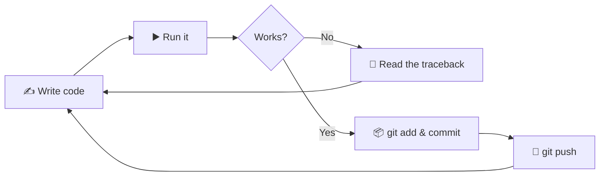

<div align="center">

# ☕ Coding Café

### Introductory Python Programming for Freshmore Students

*Small, practical coding tasks. Fail fast, learn faster.*


</div>

---

## 📖 About the Course

**Coding Café** is a hands-on, introductory course in Python programming, designed for freshmore students with little or no prior coding experience. It builds foundational programming skills through small, practical tasks with minimal theory overhead, and introduces the developer tools (the **terminal**, **Git**, and **GitHub**) that programmers are expected to know and use professionally.

The course values **experimentation, play, and iteration** over memorization. During labs, students are encouraged to *fail fast*: clarity of thinking matters more than perfect syntax. Developer habits are reinforced every week, not taught once.

> 💡 **Philosophy:** Break it, read the error, fix it, and try again. That loop is the whole job.

---

## 🎯 Learning Objectives

By the end of the course, students will be able to:

1. **Understand** the basic syntax and semantics of Python, and relate Python constructs to their C counterparts.
2. **Apply** control structures (conditionals and loops) to solve computational problems.
3. **Write** modular, readable programs using functions and modules.
4. **Use** strings, lists, dictionaries, and files effectively in programs.
5. **Apply** object-oriented concepts: classes, objects, and inheritance.
6. **Use** the terminal, `pip`, Git, and GitHub as part of a basic developer workflow.

## 🏆 Learning Outcomes

After completing the course, students should be able to:

- ✅ Write Python programs using variables, conditionals, loops, functions, and core data structures
- ✅ Explain and apply object-oriented programming concepts in Python
- ✅ Relate Python constructs to their C counterparts from **FM111**
- ✅ Use the command line to navigate the file system, run programs, and manage packages
- ✅ Use Git and GitHub to version, share, and submit code
- ✅ Read error messages, debug systematically, and handle exceptions
- ✅ Read from and write to files, and use Python libraries to extend program logic

---

## 🔁 The Café Loop

Every lab runs on the same cycle. Fail fast, learn faster.



---

## 🗓️ Weekly Plan

| Week | Session | Topic | Assessment |
|:---:|:---:|---|:---:|
| 1 | Lab | **Environments & First Programs**: installing Python and VS Code, running `.py` scripts, `print`/`input` | |
| 2 | Lecture + Lab | **Dev-Tools I: The Terminal**: navigation, paths, files, running Python from the shell, `pip` | |
| 3 | Lecture | **Variables, Data Types & Operators**: dynamic typing, operators, I/O, f-strings | |
| 4 | Lab | **Conditionals & Branching**: `if`/`elif`/`else`, Boolean logic, indentation-as-syntax | 📝 Quiz 1 |
| 5 | Lab | **Loops & Iteration**: `for`, `while`, `range`, accumulate/search/count patterns | |
| 6 | Lecture + Lab | **Dev-Tools II: Git & GitHub**: `init`, `add`, `commit`, `push`, READMEs | |
| 7 | Lab | **Functions & Modules**: `def`, arguments, return values, scope, imports, code quality | 📝 Quiz 2 |
| 8 | Lab | **Strings & Lists**: slicing, methods, comprehensions, text processing | |
| 9 | Assessment | **In-Person Assignment 1** (proctored, in lab) | 🧪 10% |
| 10 | Lab | **Dictionaries, Sets & File Handling**: text and CSV files, `try`/`except` | 📝 Quiz 3 |
| 11 | Lecture + Lab | **Object-Oriented Programming I**: classes, attributes, methods, `__init__` | |
| 12 | Lab | **Object-Oriented Programming II**: inheritance, overriding, polymorphism | |
| 13 | Lab | **Libraries & Automation**: `random`, `requests`, `matplotlib`, `pathlib`/`os` | 📝 Quiz 4 |
| 14 | Assessment | **In-Person Assignment 2** (proctored, in lab) | 🧪 10% |
| 15 | Lecture | **Revision & Wrap-Up**: course review, exam prep, bonus challenge showcase | |

---

## 🧪 Lab Journey

Each lab lives in its own folder in this repository.

| Lab | Folder | What you build |
|:---:|---|---|
| 01 | [`lab01/`](lab01) | Terminal basics and your first command-line session |
| 02 | [`lab02/`](lab02) | Jupyter notebooks, variables, primitives, and I/O |
| 03 | [`lab03/`](lab03) | Conditionals, Boolean logic, and loops |
| 04 | [`lab04/`](lab04) | Git and GitHub: the edit → stage → commit loop |
| 05 | [`lab05/`](lab05) | Functions, modules, and reading tracebacks |
| 06 | [`lab06/`](lab06) | Data structures and CSV files: menus and sales data |
| 07 | [`lab07/`](lab07) | Objects and encapsulation: a small bank for Coding Café |
| 08 | [`lab08/`](lab08) | Inheritance: *The Royal Inheritance* |
| 09 | [`lab09/`](lab09) | NumPy, pandas, and Matplotlib |

Supporting notes and logs live in [`week01/`](week01) and [`week02/`](week02).

---

## 📊 Grading

Grading is **relative** to the class.

| Component | Weight | Details |
|---|:---:|---|
| 🧑‍💻 Weekly Lab Work | **40%** | Graded lab submissions, submitted via Git from Week 6 onward |
| 📝 Quizzes | **20%** | 4 × 5%, short quizzes at concept milestones |
| 🏫 In-Person Assignments | **20%** | 2 × 10%, proctored, held in lab (Weeks 9 and 14) |
| 🎓 Final Programming Exam | **20%** | Date TBA |
| ⭐ Bonus | **up to 10%** | Optional coding challenges across the weeks (may or may not be implemented) |

---

## 📚 Recommended Resources

- 📘 **Introduction to Computation and Programming Using Python** (John Guttag, MIT Press)
- 📗 **Automate the Boring Stuff with Python** (Al Sweigart, free online)
- 🐍 [Python Documentation](https://docs.python.org/3/) (official)
- 🖥️ [Dev Tools course](https://dev-tools.mo8it.com/): terminal and Git reference
- 🎓 [The Missing Semester](https://missing.csail.mit.edu): developer tools and coding practice
- 🌿 *Pro Git*, Chapters 1–2 (free online)
- 🌐 [W3Schools Python Tutorial](https://www.w3schools.com/python/)
- 💬 r/learnpython on Reddit

---

## 🧭 Course Policies

- **Makeup:** Students who miss an evaluation for an extenuating circumstance (serious medical issue, personal or family emergency, or official University representation) may apply for makeup through the instructor of record with supporting documentation.
- **Attendance:** Excused absences with valid documentation do not penalize attendance scores.
- **Collaboration:** Pair programming is encouraged in designated labs. In-person assignments, quizzes, and the final exam are **individual efforts** unless stated otherwise.
- **Academic integrity:** Zero tolerance for scholastic misconduct, however minor. Cases may be referred to the Academic Integrity Committee.

---

## 🚀 Quick Start

```bash
# 1. Clone the café
git clone https://github.com/HitarthNijhara/coding-cafe.git
cd coding-cafe

# 2. Create a virtual environment and activate it
python3 -m venv .venv
source .venv/bin/activate        # Windows: .venv\Scripts\activate

# 3. Run any Python script, or open a notebook
python3 your_script.py
pip install jupyter && jupyter notebook   # for the .ipynb labs
```

---

## 🗂️ Repository Layout

```
coding-cafe/
├── README.md        ← you are here
├── week01/          ← week 1 notes and logs
├── week02/          ← week 2 notes and logs
├── lab01/ … lab09/  ← lab notebooks, scripts, and write-ups
└── .gitignore
```

---

## 👩‍🎓 Student

**Hitarth Nijhara**

*Made with Python, curiosity, and a lot of coffee.* ☕

<div align="center">

---

*Coding Café · FM102 · Happy coding!*

</div>
